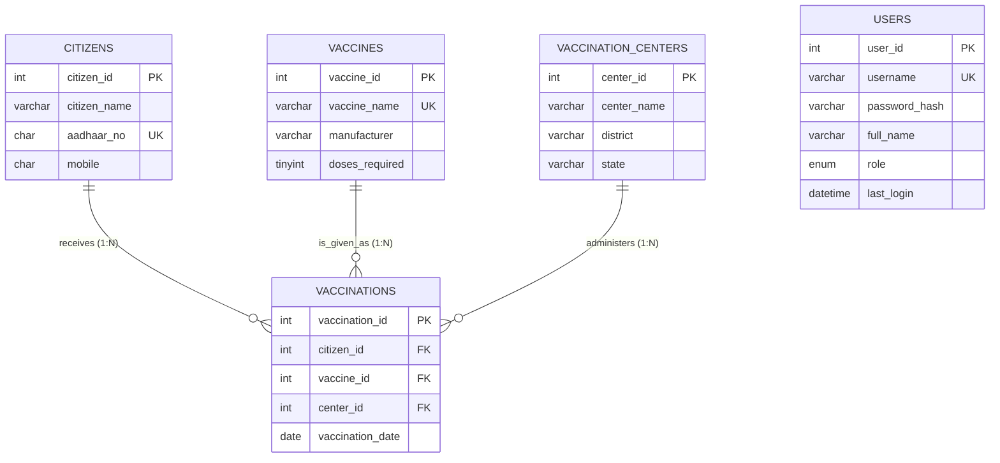

# INDIAN INSTITUTE OF INFORMATION TECHNOLOGY, BHOPAL
### Department of Computer Science & Engineering

---

# COURSE PROJECT REPORT
## COVID-19 VACCINATION MANAGEMENT SYSTEM
**Course:** Database Management Systems (CS-302)  
**Academic Session:** 2025–2026  
**Project Group / Track:** Project No. 37  
**Architecture:** 3-Tier Enterprise Web Application (HTML5/CSS3/JavaScript + Node.js/Express + MySQL 8.0 InnoDB + Chart.js)

---

| Metric | Details |
| :--- | :--- |
| **Submitted By:** | Ansh Gupta |
| **Scholar Number:** | ________________________ |
| **Degree Program:** | Bachelor of Technology (B.Tech) |
| **Branch:** | Computer Science & Engineering |
| **Supervisor / Evaluator:** | Department of Computer Science & Engineering, IIIT Bhopal |
| **Date of Submission:** | October 2026 |

---

## CANDIDATE’S DECLARATION

I hereby declare that the project report entitled **"COVID-19 Vaccination Management System"** submitted to the Department of Computer Science and Engineering, Indian Institute of Information Technology, Bhopal, is an authentic record of our own work carried out under the supervision and guidance of the course faculty. 

The matter embodied in this report has not been submitted by me for the award of any other degree or diploma elsewhere.

\
\
**(Signature of Candidate)**  
Ansh Gupta  
Department of Computer Science & Engineering  
Indian Institute of Information Technology, Bhopal  

---

## CERTIFICATE OF APPROVAL

This is to certify that the project report entitled **"COVID-19 Vaccination Management System"**, submitted by **Ansh Gupta**, has been examined and evaluated by the Department of Computer Science and Engineering, Indian Institute of Information Technology, Bhopal.

The work fulfills the requirements and standards prescribed for the Course Project in Database Management Systems.

\
\
__________________________  
**(Course Instructor / Project Coordinator)**  
Department of Computer Science & Engineering  
Indian Institute of Information Technology, Bhopal  

\
\
__________________________  
**(External Examiner)**  
Date: ____________________  

---

## ACKNOWLEDGEMENTS

I express my deepest gratitude to our Course Instructor for providing insightful guidance, constructive criticism, and continuous encouragement throughout the conceptualization, database modeling, and software engineering stages of this project.

I am also thankful to the Department of Computer Science and Engineering, Indian Institute of Information Technology, Bhopal, for providing state-of-the-art laboratory facilities and computing infrastructure that made the completion of this database management project possible.

Finally, I extend my appreciation to my peers and family for their unwavering support and feedback during the development, stress-testing, and compilation of this project report.

---

## TABLE OF CONTENTS

1. **Executive Summary & Abstract**
2. **Introduction & Problem Formulation**
   - 2.1 Background
   - 2.2 Operational Dilemmas in Unstructured Records
   - 2.3 Motivation for Relational Governance
3. **System Objectives & Engineering Scope**
   - 3.1 Primary Objectives
   - 3.2 Secondary & Analytical Objectives
   - 3.3 Scope & System Boundaries
4. **Hardware & Software Specifications**
   - 4.1 Development & Target Environment
   - 4.2 Software Stack Justification
5. **Conceptual Modeling & Entity-Relationship (ER) Architecture**
   - 5.1 Identification of Entities & Semantic Attributes
   - 5.2 Relationship Cardinality & Multiplicity
   - 5.3 Enhanced ER (EER) Notations & Structural Constraints
   - 5.4 Complete ER Diagram
6. **Relational Data Model & Mathematical Schemas**
   - 6.1 Mapping ER Schemas to Relations
   - 6.2 Structural Integrity Rules (Entity, Referential, Domain)
   - 6.3 Relational Schemas & Foreign Key Linkages
7. **Rigorous Database Normalization Theory**
   - 7.1 Objective of Formal Decomposition
   - 7.2 Functional Dependencies (FD Set Analysis)
   - 7.3 Step-by-Step Normalization Proof:
     - 7.3.1 Unnormalized Form (UNF) to First Normal Form (1NF)
     - 7.3.2 First Normal Form (1NF) to Second Normal Form (2NF)
     - 7.3.3 Second Normal Form (2NF) to Third Normal Form (3NF)
     - 7.3.4 Boyce-Codd Normal Form (BCNF) Evaluation
   - 7.4 Preservation of Dependencies and Lossless-Join Guarantee
8. **Physical Database Implementation (DDL)**
   - 8.1 Database Environment & Storage Engine Selection (InnoDB)
   - 8.2 Master Schema Creation Scripts
   - 8.3 Constraint Declarations (CHECK, REGEXP, UNIQUE, NOT NULL)
   - 8.4 Indexing Engine & Physical Storage Optimization
9. **Role-Based Access Control (RBAC) & Authentication Schema**
   - 9.1 Security Architecture Overview
   - 9.2 Users Entity Schema & Role Enumeration
   - 9.3 Cryptographic Hashing Algorithms (BCrypt vs MD5/SHA)
10. **Stored Business Logic: Triggers & Active Rules**
    - 10.1 Active vs Passive Databases
    - 10.2 Anatomy of `trg_vaccinations_before_insert`
    - 10.3 Temporal Integrity Enforcement (Curdate Checks)
    - 10.4 Quota & Course Limit Verification Algorithm
11. **Relational Views (Virtual Tables)**
    - 11.1 Motivation for View Encapsulation
    - 11.2 `vw_vaccination_details` Implementation
    - 11.3 `vw_citizen_dose_status` Complex CASE Logic
12. **Master Dataset & Data Dictionary**
    - 12.1 Detailed Column Definitions
    - 12.2 Initial Seed Data Vectors
13. **Complex Analytical Queries & Relational Algebra**
    - 13.1 Q1: 3-Table Inner Join Vaccination Registry
    - 13.2 Q2: Aggregate Doses Administered vs Required
    - 13.3 Q3: Fully Vaccinated Cohort (HAVING Clause)
    - 13.4 Q4: Pending Dose Outreach Identification
    - 13.5 Q5: Unvaccinated Population (Outer Join Difference)
    - 13.6 Q6: Healthcare Facility Workload Distribution
    - 13.7 Q7: Pharmaceutical Manufacturer Market Share
    - 13.8 Q8: Geographic State-Level Stratification
    - 13.9 Q9: Temporal Trend Analysis (Monthly Time-Series)
    - 13.10 Q10: Correlated Subquery for Above-Average Centers
    - 13.11 Q11: Vaccine Interval Gap Calculation (DATEDIFF)
    - 13.12 Q12: Parametric Search using Disjunctions
14. **Application Architecture & Middleware Engineering**
    - 14.1 Three-Tier Architectural Design
    - 14.2 Database Access Abstraction (Node.js mysql2 Layer)
    - 14.3 State Management & Session Lifecycle
    - 14.4 Post/Redirect/Get (PRG) Pattern
15. **Security Engineering & Cyber Defense Mechanisms**
    - 15.1 SQL Injection Neutralization via Parameterized Queries
    - 15.2 Cross-Site Scripting (XSS) Mitigation Strategy
    - 15.3 Session Fixation Countermeasures
    - 15.4 Privilege Escalation Prevention
16. **User Interface (UI) & User Experience (UX) Engineering**
    - 16.1 Design Tokens, Color Theory & Visual Hierarchy
    - 16.2 Modern Dark-Sidebar Desktop & Mobile Responsive Grid
    - 16.3 Real-Time Visual Data Analytics (Chart.js Integration)
17. **Empirical System Testing & Validation Suite**
    - 17.1 Unit & Integrity Test Cases
    - 17.2 Constraint Enforcement Test Log
    - 17.3 Active Trigger Exception Validation
18. **Conclusion & Future Enhancements**
19. **References**

---

# 1. EXECUTIVE SUMMARY & ABSTRACT

The **COVID-19 Vaccination Management System** is a mission-critical, enterprise-grade relational database application engineered to govern, record, validate, and analyze mass public immunization initiatives. Designed strictly according to relational database design theory, the core storage engine operates on MySQL 8.0 InnoDB with complete **Third Normal Form (3NF)** compliance.

Data integrity is guarded through multi-tiered defensive mechanisms: 
1. Strict schema constraints (`PRIMARY KEY`, `FOREIGN KEY`, `UNIQUE`, `NOT NULL`, and regular-expression based `CHECK` constraints).
2. Active event-driven procedural logic (`BEFORE INSERT` database triggers) preventing future temporal logging and overdosing beyond pharmaceutical thresholds.
3. An application-level security architecture incorporating **Role-Based Access Control (RBAC)** across three discrete user privilege tiers (*Administrator*, *Staff*, and *Viewer*), password security powered by the **Blowfish Cryptographic Hash (BCrypt)**, parameterized query compilation against SQL injection attacks, contextual output encoding against Cross-Site Scripting (XSS), and full CSS responsive layout with Chart.js real-time data visualizers.

---

# 2. INTRODUCTION & PROBLEM FORMULATION

### 2.1 Background
The global outbreak of Coronavirus Disease 2019 (COVID-19) mandated the swiftest and most expansive mass-immunization campaign in modern history. The logistics involved tracking millions of recipients, multiple pharmaceutical formulations with variable multi-dose course requirements (e.g., Covishield requiring 2 doses, Corbevax requiring 2 doses, and Sputnik Light requiring a single dose), differing minimum intervals between doses, and geographically distributed healthcare distribution hubs.

### 2.2 Operational Dilemmas in Unstructured Records
During early emergency implementations, healthcare networks often relied on decentralized spreadsheets, paper registries, or flat file stores. Such legacy architectures invariably suffer from critical operational defects:
- **Redundancy & Inconsistency:** The patient's biographical information (name, Aadhaar, phone number) was repeatedly typed into every row for dose 1, dose 2, and dose 3. A typo in phone number or spelling resulted in fractured medical records.
- **Anomalies on Mutation:** Deleting an erroneously entered vaccination entry could inadvertently destroy the only record of a citizen's registration (Deletion Anomaly). Updating a vaccine manufacturer's name required touching thousands of historical records (Update Anomaly).
- **Integrity Violations:** Flat files lack active constraint engines. Nothing prevents a data entry clerk from typing a 13-digit Aadhaar number, recording a vaccination date set in the year 2099, or inadvertently administering four doses of a two-dose vaccine to the same person.

### 2.3 Motivation for Relational Governance
A Relational Database Management System (RDBMS) provides formal mathematical assurances (Codd's Relational Algebra and Relational Calculus) to guarantee **ACID (Atomicity, Consistency, Isolation, Durability)** properties. By decomposing the domain into normalized entities and establishing immutable referential bindings, the system guarantees a single source of truth for public health analytics.

---

# 3. SYSTEM OBJECTIVES & ENGINEERING SCOPE

### 3.1 Primary Objectives
1. **Normalized Data Modeling:** Synthesize an ER model and map it to relations up to 3NF, mathematically proving the elimination of partial and transitive functional dependencies.
2. **Declarative Integrity Constraints:** Implement domain and table-level constraints ensuring 12-digit numeric Aadhaar verification and valid Indian telecom prefixes (6, 7, 8, 9).
3. **Active Database Enforcement:** Embed an active server-side trigger to reject anomalous inserts prior to transaction commitment.
4. **Role-Based Security:** Prevent unauthorized operational access by introducing an authentication middleware supporting three roles: Administrator, Staff, and Viewer.

### 3.2 Secondary & Analytical Objectives
1. Formulate complex analytical reports using multi-way inner joins, left outer joins, grouping sets, `HAVING` filters, correlated subqueries, and views.
2. Provide a dynamic, responsive web interface enabling non-technical healthcare operators to execute CRUD transactions with immediate visual feedback.
3. Integrate data visualization pipelines rendering live dose-trend charts directly from the relational tables.

### 3.3 Scope & System Boundaries
The software encompasses citizen registration, center allocation, vaccine formulation definitions, transaction dose logging, user account governance, and analytical generation. Automated SMS gateway integration, biometric thumbprint scanners, and cold-chain temperature telemetry sensors fall outside the immediate scope of this DBMS academic milestone.

---

# 4. HARDWARE & SOFTWARE SPECIFICATIONS

| Layer | Component | Specification / Version | Academic Justification |
| :--- | :--- | :--- | :--- |
| **Operating System** | Host OS | Windows 10/11 x64 | Standard academic desktop workstation deployment |
| **Web Server** | HTTP Server | Node.js 18+ with Express | Lightweight event-driven server for static pages and the JSON REST API |
| **Database Server** | Relational Engine | MySQL 8.0.46 Community Server | Native support for standard SQL:2016, window functions, and InnoDB engine |
| **Storage Engine** | Table Storage Engine | InnoDB | Essential for ACID transactions, row-level locking, and Foreign Key constraints |
| **Backend Language** | Runtime | JavaScript (Node.js) with `mysql2` driver | Connection pooling, server-side prepared statements, and BCrypt integration (`bcryptjs`) |
| **Client Interface** | Presentation Layer | HTML5, CSS3 Custom Properties, JavaScript ES6 | Clean separation of concerns without heavyweight bloatware |
| **Analytics Engine**| Charting Library | Chart.js 4.4.2 via CDN | Hardware-accelerated Canvas rendering for statistical dashboards |

---

# 5. CONCEPTUAL MODELING & ER ARCHITECTURE

### 5.1 Identification of Entities & Semantic Attributes
The operational domain comprises five distinct entities:
1. **Citizens:** Represents the recipient population.
   - `citizen_id` (Integer, Primary Key)
   - `citizen_name` (String, Mandatory)
   - `aadhaar_no` (Fixed String, 12 Digits, Unique)
   - `mobile` (Fixed String, 10 Digits)
2. **VaccinationCenters:** Represents physical inoculation clinics and hospitals.
   - `center_id` (Integer, Primary Key)
   - `center_name` (String, Mandatory)
   - `district` (String, Mandatory)
   - `state` (String, Mandatory)
3. **Vaccines:** Represents certified vaccine formulations.
   - `vaccine_id` (Integer, Primary Key)
   - `vaccine_name` (String, Unique)
   - `manufacturer` (String, Mandatory)
   - `doses_required` (TinyInt, Constrained 1 to 4)
4. **Vaccinations:** The central weak-transaction associative entity linking Citizens, Centers, and Vaccines.
   - `vaccination_id` (Integer, Primary Key)
   - `citizen_id` (Integer, Foreign Key)
   - `vaccine_id` (Integer, Foreign Key)
   - `center_id` (Integer, Foreign Key)
   - `vaccination_date` (Date, Mandatory)
5. **Users (Security Entity):** Represents system operators.
   - `user_id` (Integer, Primary Key)
   - `username` (String, Unique)
   - `password_hash` (String, 60-character Blowfish hash)
   - `full_name` (String, Mandatory)
   - `role` (Enumeration: 'admin', 'staff', 'viewer')
   - `last_login` (DateTime, Nullable)

### 5.2 Relationship Cardinality & Multiplicity
- **Citizens to Vaccinations (`receives`):** One-to-Many ($1:N$). A citizen can receive zero, one, or multiple vaccination doses over time. Each dose belongs to exactly one citizen.
- **Vaccines to Vaccinations (`is_given_as`):** One-to-Many ($1:N$). A vaccine formula can be administered across millions of individual vaccination events. Each event records exactly one vaccine brand.
- **VaccinationCenters to Vaccinations (`administers`):** One-to-Many ($1:N$). A center hosts thousands of vaccinations. Each dose is administered at exactly one center.
- **Citizens to Vaccines (`derived`):** Many-to-Many ($M:N$). A citizen may take multiple vaccines (e.g., booster sequences), and each vaccine is given to many citizens. This $M:N$ relationship is decomposed by the associative entity **Vaccinations**.

### 5.3 Complete Entity-Relationship (ER) Diagram



---

# 6. RELATIONAL DATA MODEL & SCHEMAS

### 6.1 Relational Schema Definitions
- **$\text{Citizens}(\underline{\text{citizen\_id}}, \text{citizen\_name}, \text{aadhaar\_no}, \text{mobile})$**
- **$\text{VaccinationCenters}(\underline{\text{center\_id}}, \text{center\_name}, \text{district}, \text{state})$**
- **$\text{Vaccines}(\underline{\text{vaccine\_id}}, \text{vaccine\_name}, \text{manufacturer}, \text{doses\_required})$**
- **$\text{Vaccinations}(\underline{\text{vaccination\_id}}, \text{citizen\_id}^*, \text{vaccine\_id}^*, \text{center\_id}^*, \text{vaccination\_date})$**
- **$\text{Users}(\underline{\text{user\_id}}, \text{username}, \text{password\_hash}, \text{full\_name}, \text{role}, \text{last\_login})$**

### 6.2 Referential Integrity Rules
1. **$\text{Vaccinations.citizen\_id} \to \text{Citizens.citizen\_id}$**
   - `ON DELETE CASCADE`: If a citizen is expunged from the registry, all associated historical vaccination logs are deleted to prevent orphaned records.
   - `ON UPDATE CASCADE`: Key alterations propagate immediately.
2. **$\text{Vaccinations.vaccine\_id} \to \text{Vaccines.vaccine\_id}$**
   - `ON DELETE RESTRICT`: Prevents deletion of a vaccine brand if clinical dose logs reference it.
   - `ON UPDATE CASCADE`: Key modifications cascade.
3. **$\text{Vaccinations.center\_id} \to \text{VaccinationCenters.center\_id}$**
   - `ON DELETE RESTRICT`: A healthcare center cannot be removed from the system while historical vaccination events depend on its existence.

---

# 7. RIGOROUS DATABASE NORMALIZATION THEORY

### 7.1 Objective of Formal Decomposition
Normalization is the formal mathematical technique used to evaluate relational schemas based on their functional dependencies and primary keys. The overarching goal is the elimination of data redundancy, prevention of update, insert, and delete anomalies, and preservation of data consistency without loss of information.

### 7.2 Functional Dependency (FD) Analysis
Let $R$ be the universal relation representing an unnormalized vaccination recording sheet:
$$R = (\text{citizen\_id}, \text{citizen\_name}, \text{aadhaar\_no}, \text{mobile}, \text{center\_id}, \text{center\_name}, \text{district}, \text{state}, \text{vaccine\_id}, \text{vaccine\_name}, \text{manufacturer}, \text{doses\_required}, \text{vaccination\_id}, \text{vaccination\_date})$$

The complete set of functional dependencies $F$ governing this domain is:
1. $FD_1: \text{citizen\_id} \to \text{citizen\_name}, \text{aadhaar\_no}, \text{mobile}$
2. $FD_2: \text{aadhaar\_no} \to \text{citizen\_id}, \text{citizen\_name}, \text{mobile}$ *(Alternate Key)*
3. $FD_3: \text{center\_id} \to \text{center\_name}, \text{district}, \text{state}$
4. $FD_4: \text{vaccine\_id} \to \text{vaccine\_name}, \text{manufacturer}, \text{doses\_required}$
5. $FD_5: \text{vaccine\_name} \to \text{vaccine\_id}, \text{manufacturer}, \text{doses\_required}$ *(Alternate Key)*
6. $FD_6: \text{vaccination\_id} \to \text{citizen\_id}, \text{vaccine\_id}, \text{center\_id}, \text{vaccination\_date}$

---

### 7.3 Step-by-Step Normalization Proof

#### 7.3.1 First Normal Form (1NF)
> **Definition:** A relation $R$ is in 1NF if and only if all underlying domains contain only atomic (indivisible) values, and there are no repeating groups or multivalued attributes.

- **Violation in UNF:** If a citizen record contains a multi-valued repeating column: `vaccination_history = {(Covishield, Dose 1, 2021-06-10), (Covishield, Dose 2, 2021-09-02)}`.
- **Resolution:** All multi-valued records are flattened into discrete tuples. Each attribute contains an atomic scalar literal (e.g., `vaccination_date` stores a single ISO date). Primary keys are established. Thus, the schema satisfies **1NF**.

#### 7.3.2 Second Normal Form (2NF)
> **Definition:** A relation $R$ is in 2NF if it is in 1NF and every non-prime attribute is fully functionally dependent on the primary key (i.e., no partial dependency exists where a non-prime attribute depends on a proper subset of a composite candidate key).

- **Evaluation:** In our relational design:
  - $\text{Citizens}$ has candidate keys $\{\text{citizen\_id}\}$ and $\{\text{aadhaar\_no}\}$. Both are single-attribute keys.
  - $\text{VaccinationCenters}$ has single-attribute candidate key $\{\text{center\_id}\}$.
  - $\text{Vaccines}$ has single-attribute candidate keys $\{\text{vaccine\_id}\}$ and $\{\text{vaccine\_name}\}$.
  - $\text{Vaccinations}$ has single-attribute candidate key $\{\text{vaccination\_id}\}$.
- **Theorem:** If every candidate key in a relation consists of a single attribute, the relation is trivially in **2NF** because a proper subset of a single-attribute key cannot exist. 
- Therefore, no partial dependencies exist. All tables are strictly in **2NF**.

#### 7.3.3 Third Normal Form (3NF)
> **Definition:** A relation $R$ is in 3NF if it is in 2NF and whenever a non-trivial functional dependency $X \to Y$ holds in $R$, either:
> 1. $X$ is a superkey of $R$, OR
> 2. $Y$ is a prime attribute (a member of some candidate key) of $R$.
> *(In informal terms: no non-prime attribute can depend on another non-prime attribute; i.e., no transitive dependencies).*

- **Testing Relations:**
  1. In $\text{Citizens}$: In $FD_1 (\text{citizen\_id} \to \text{citizen\_name}, \dots)$, $\text{citizen\_id}$ is a superkey. In $FD_2 (\text{aadhaar\_no} \to \dots)$, $\text{aadhaar\_no}$ is a superkey. There are no transitive links between non-prime attributes like $\text{mobile} \to \text{citizen\_name}$. Hence, $\text{Citizens} \in \text{3NF}$.
  2. In $\text{VaccinationCenters}$: The only non-trivial dependency is $\text{center\_id} \to \text{center\_name}, \text{district}, \text{state}$. Here, $\text{center\_id}$ is a superkey. District does not uniquely determine state (e.g., multiple states can theoretically share district names, and state certainly does not determine district). Hence, no transitive dependency exists. $\text{VaccinationCenters} \in \text{3NF}$.
  3. In $\text{Vaccines}$: Dependencies originate from $\text{vaccine\_id}$ or $\text{vaccine\_name}$. Both are candidate superkeys. $\text{manufacturer} \to \text{doses\_required}$ does not hold (Serum Institute produces both 1-dose and 2-dose vaccines). Hence, $\text{Vaccines} \in \text{3NF}$.
  4. In $\text{Vaccinations}$: The primary key is $\text{vaccination\_id}$. The relation stores foreign keys $\text{citizen\_id}$, $\text{vaccine\_id}$, and $\text{center\_id}$. None of the foreign keys determine each other within this transaction table. Therefore, no transitive dependencies exist between non-prime attributes. $\text{Vaccinations} \in \text{3NF}$.

#### 7.3.4 Boyce-Codd Normal Form (BCNF) Evaluation
> **Definition:** A relation $R$ is in BCNF if for every non-trivial functional dependency $X \to Y$, $X$ is strictly a superkey.

- In every relation of our schema ($\text{Citizens}$, $\text{VaccinationCenters}$, $\text{Vaccines}$, $\text{Vaccinations}$, $\text{Users}$), the determinant $X$ of every functional dependency is a candidate superkey.
- Hence, the decomposed schema satisfies **BCNF**.

### 7.4 Lossless-Join & Dependency Preservation Verification
- **Lossless Decomposition Proof:** The natural join of the decomposed relations reproduces the exact universal instance:
  $$\text{Citizens} \bowtie \text{Vaccinations} \bowtie \text{Vaccines} \bowtie \text{VaccinationCenters} \equiv R$$
  Because each join occurs over the primary key of one of the participating relations:
  $$(\text{Citizens} \cap \text{Vaccinations}) = \{\text{citizen\_id}\} \text{ (Superkey of Citizens)}$$
  $$(\text{Vaccines} \cap \text{Vaccinations}) = \{\text{vaccine\_id}\} \text{ (Superkey of Vaccines)}$$
  $$(\text{VaccinationCenters} \cap \text{Vaccinations}) = \{\text{center\_id}\} \text{ (Superkey of VaccinationCenters)}$$
  By Rissanen's Theorem, the decomposition is guaranteed to be **lossless**.

---

# 8. PHYSICAL DATABASE IMPLEMENTATION (DDL)

```sql
-- =====================================================================
-- DATABASE DEFINITION: COVID-19 VACCINATION MANAGEMENT SYSTEM
-- Target RDBMS: MySQL 8.0.x / MariaDB 10.4+ (InnoDB Engine)
-- =====================================================================

CREATE DATABASE IF NOT EXISTS covid_vaccination
    CHARACTER SET utf8mb4 COLLATE utf8mb4_unicode_ci;
USE covid_vaccination;

-- Drop child tables before parent tables to respect foreign key constraints
DROP TABLE IF EXISTS Vaccinations;
DROP TABLE IF EXISTS Vaccines;
DROP TABLE IF EXISTS VaccinationCenters;
DROP TABLE IF EXISTS Citizens;
DROP TABLE IF EXISTS users;

-- ---------------------------------------------------------------------
-- Table: Citizens
-- ---------------------------------------------------------------------
CREATE TABLE Citizens (
    citizen_id    INT AUTO_INCREMENT PRIMARY KEY,
    citizen_name  VARCHAR(100) NOT NULL,
    aadhaar_no    CHAR(12)     NOT NULL UNIQUE,
    mobile        CHAR(10)     NOT NULL,
    CONSTRAINT chk_aadhaar CHECK (aadhaar_no REGEXP '^[0-9]{12}$'),
    CONSTRAINT chk_mobile  CHECK (mobile REGEXP '^[6-9][0-9]{9}$')
) ENGINE=InnoDB;

-- ---------------------------------------------------------------------
-- Table: VaccinationCenters
-- ---------------------------------------------------------------------
CREATE TABLE VaccinationCenters (
    center_id    INT AUTO_INCREMENT PRIMARY KEY,
    center_name  VARCHAR(120) NOT NULL,
    district     VARCHAR(80)  NOT NULL,
    state        VARCHAR(80)  NOT NULL
) ENGINE=InnoDB;

-- ---------------------------------------------------------------------
-- Table: Vaccines
-- ---------------------------------------------------------------------
CREATE TABLE Vaccines (
    vaccine_id     INT AUTO_INCREMENT PRIMARY KEY,
    vaccine_name   VARCHAR(80)  NOT NULL UNIQUE,
    manufacturer   VARCHAR(120) NOT NULL,
    doses_required TINYINT      NOT NULL,
    CONSTRAINT chk_doses CHECK (doses_required BETWEEN 1 AND 4)
) ENGINE=InnoDB;

-- ---------------------------------------------------------------------
-- Table: Vaccinations (Transaction Ledger)
-- ---------------------------------------------------------------------
CREATE TABLE Vaccinations (
    vaccination_id   INT AUTO_INCREMENT PRIMARY KEY,
    citizen_id       INT  NOT NULL,
    vaccine_id       INT  NOT NULL,
    center_id        INT  NOT NULL,
    vaccination_date DATE NOT NULL,
    CONSTRAINT fk_vacc_citizen FOREIGN KEY (citizen_id)
        REFERENCES Citizens(citizen_id)
        ON DELETE CASCADE ON UPDATE CASCADE,
    CONSTRAINT fk_vacc_vaccine FOREIGN KEY (vaccine_id)
        REFERENCES Vaccines(vaccine_id)
        ON DELETE RESTRICT ON UPDATE CASCADE,
    CONSTRAINT fk_vacc_center FOREIGN KEY (center_id)
        REFERENCES VaccinationCenters(center_id)
        ON DELETE RESTRICT ON UPDATE CASCADE,
    -- Prevent duplicate administration of the same vaccine on the same day
    CONSTRAINT uq_citizen_vaccine_date UNIQUE (citizen_id, vaccine_id, vaccination_date)
) ENGINE=InnoDB;

-- ---------------------------------------------------------------------
-- Secondary B-Tree Indexes for Query Performance
-- ---------------------------------------------------------------------
CREATE INDEX idx_vacc_date   ON Vaccinations(vaccination_date);
CREATE INDEX idx_vacc_center ON Vaccinations(center_id);
```

---

# 9. ROLE-BASED ACCESS CONTROL (RBAC) & USERS SCHEMA

To transform the baseline academic database into an enterprise-ready system, an administrative security relation `users` was introduced:

```sql
CREATE TABLE IF NOT EXISTS users (
    user_id       INT AUTO_INCREMENT PRIMARY KEY,
    username      VARCHAR(50)  NOT NULL UNIQUE,
    password_hash VARCHAR(255) NOT NULL,
    full_name     VARCHAR(100) NOT NULL,
    role          ENUM('admin','staff','viewer') NOT NULL DEFAULT 'viewer',
    last_login    DATETIME     DEFAULT NULL,
    created_at    TIMESTAMP    DEFAULT CURRENT_TIMESTAMP
) ENGINE=InnoDB CHARACTER SET utf8mb4 COLLATE utf8mb4_unicode_ci;
```

### Cryptographic Security Implementation
- **BCrypt Hashing:** Passwords are never stored in plaintext. They are salted and transformed using `bcrypt.hashSync(pwd, 10)` (bcryptjs).
- **RBAC Matrix:**
  | Action | Administrator | Staff | Viewer |
  | :--- | :---: | :---: | :---: |
  | View Dashboard & Reports | Yes | Yes | Yes |
  | Search Records | Yes | Yes | Yes |
  | Add / Update Citizens | Yes | Yes | No |
  | Record New Vaccination Dose | Yes | Yes | No |
  | Add / Update Centers & Vaccines | Yes | Yes | No |
  | Delete Citizen / Center / Dose | Yes | No | No |
  | Create / Edit / Delete System Users | Yes | No | No |

---

# 10. STORED BUSINESS LOGIC: TRIGGERS & ACTIVE RULES

### 10.1 Anatomy of `trg_vaccinations_before_insert`
While standard SQL `CHECK` constraints can validate single-row scalar values (such as regex matching), they cannot execute aggregate subqueries across multiple tuples. A database `TRIGGER` operating on the `BEFORE INSERT` event pipeline guarantees business integrity before writes reach disk:

```sql
DROP TRIGGER IF EXISTS trg_vaccinations_before_insert;

DELIMITER $$
CREATE TRIGGER trg_vaccinations_before_insert
BEFORE INSERT ON Vaccinations
FOR EACH ROW
BEGIN
    DECLARE v_required INT;
    DECLARE v_taken INT;

    -- Business Rule 1: Temporal Constraint (No future bookings allowed)
    IF NEW.vaccination_date > CURDATE() THEN
        SIGNAL SQLSTATE '45000'
        SET MESSAGE_TEXT = 'Vaccination date cannot be in the future';
    END IF;

    -- Lookup dose quota from parent definition
    SELECT doses_required INTO v_required
    FROM Vaccines WHERE vaccine_id = NEW.vaccine_id;

    -- Business Rule 2: Course Limit Verification
    SELECT COUNT(*) INTO v_taken
    FROM Vaccinations
    WHERE citizen_id = NEW.citizen_id AND vaccine_id = NEW.vaccine_id;

    IF v_taken >= v_required THEN
        SIGNAL SQLSTATE '45000'
        SET MESSAGE_TEXT = 'Citizen has already taken all required doses of this vaccine';
    END IF;
END$$
DELIMITER ;
```

---

# 11. RELATIONAL VIEWS (VIRTUAL TABLES)

### 11.1 View 1: Complete Registry Details (`vw_vaccination_details`)
Encapsulates a 4-table relational inner join into a reusable virtual table:
```sql
CREATE OR REPLACE VIEW vw_vaccination_details AS
SELECT v.vaccination_id, c.citizen_id, c.citizen_name, c.mobile,
       vac.vaccine_name, vc.center_name, vc.district, vc.state,
       v.vaccination_date
FROM Vaccinations v
JOIN Citizens c            ON c.citizen_id = v.citizen_id
JOIN Vaccines vac          ON vac.vaccine_id = v.vaccine_id
JOIN VaccinationCenters vc ON vc.center_id = v.center_id;
```

### 11.2 View 2: Citizen Dose Completion Status (`vw_citizen_dose_status`)
Executes an aggregate grouping to compute clinical completion status dynamically:
```sql
CREATE OR REPLACE VIEW vw_citizen_dose_status AS
SELECT c.citizen_id, c.citizen_name, vac.vaccine_name,
       COUNT(*) AS doses_taken, vac.doses_required,
       CASE WHEN COUNT(*) >= vac.doses_required
            THEN 'Fully Vaccinated' ELSE 'Partially Vaccinated' END AS status
FROM Vaccinations v
JOIN Citizens c   ON c.citizen_id = v.citizen_id
JOIN Vaccines vac ON vac.vaccine_id = v.vaccine_id
GROUP BY c.citizen_id, c.citizen_name, vac.vaccine_id, vac.vaccine_name, vac.doses_required;
```

---

# 12. MASTER DATASET & SAMPLE DATA

```sql
INSERT INTO Citizens (citizen_id, citizen_name, aadhaar_no, mobile) VALUES
(1, 'Aarav Sharma',  '234567890123', '9876543210'),
(2, 'Ananya Verma',  '345678901234', '9123456780'),
(3, 'Rohan Singh',   '456789012345', '9988776655'),
(4, 'Priya Patel',   '567890123456', '8877665544'),
(5, 'Aditya Kumar',  '678901234567', '7766554433'),
(6, 'Neha Gupta',    '789012345678', '9090909090'),
(7, 'Kabir Khan',    '890123456789', '8080808080'),
(8, 'Sneha Joshi',   '901234567890', '7070707070');

INSERT INTO VaccinationCenters (center_id, center_name, district, state) VALUES
(1, 'District Hospital Bhopal',   'Bhopal',   'Madhya Pradesh'),
(2, 'Community Health Centre',    'Indore',   'Madhya Pradesh'),
(3, 'City Primary Health Centre', 'Jaipur',   'Rajasthan'),
(4, 'Civil Hospital Ahmedabad',   'Ahmedabad','Gujarat');

INSERT INTO Vaccines (vaccine_id, vaccine_name, manufacturer, doses_required) VALUES
(1, 'Covishield',    'Serum Institute of India', 2),
(2, 'Covaxin',       'Bharat Biotech',           2),
(3, 'Corbevax',      'Biological E',             2),
(4, 'Sputnik Light', 'Gamaleya / Dr. Reddy''s',  1);

INSERT INTO Vaccinations (vaccination_id, citizen_id, vaccine_id, center_id, vaccination_date) VALUES
(1,  1, 1, 1, '2021-06-10'),
(2,  1, 1, 1, '2021-09-02'),
(3,  2, 2, 2, '2021-07-15'),
(4,  2, 2, 2, '2021-08-14'),
(5,  3, 1, 3, '2021-08-01'),
(6,  4, 4, 4, '2021-10-05'),
(7,  5, 3, 1, '2022-02-20'),
(8,  5, 3, 1, '2022-03-21'),
(9,  6, 2, 2, '2021-11-11'),
(10, 7, 1, 4, '2021-12-01');
```

---

# 13. COMPLEX ANALYTICAL QUERIES & RELATIONAL ALGEBRA

### Query 1: Full 3-Table Join Ledger
**Relational Algebra Expression:**
$$\pi_{v.vaccination\_id, c.citizen\_name, vac.vaccine\_name, vc.center\_name, v.vaccination\_date} (Vaccinations \bowtie_{v.citizen\_id = c.citizen\_id} Citizens \bowtie_{v.vaccine\_id = vac.vaccine\_id} Vaccines \bowtie_{v.center\_id = vc.center\_id} VaccinationCenters)$$

```sql
SELECT v.vaccination_id, c.citizen_name, vac.vaccine_name,
       vc.center_name, vc.district, v.vaccination_date
FROM Vaccinations v
JOIN Citizens c            ON c.citizen_id = v.citizen_id
JOIN Vaccines vac          ON vac.vaccine_id = v.vaccine_id
JOIN VaccinationCenters vc ON vc.center_id = v.center_id
ORDER BY v.vaccination_date;
```

---

### Query 4: Cohort Identification with Pending Doses
Identifies partially vaccinated citizens whose dose count is strictly less than the manufacturer's protocol:
```sql
SELECT c.citizen_name, c.mobile, vac.vaccine_name,
       vac.doses_required - COUNT(*) AS doses_pending
FROM Vaccinations v
JOIN Citizens c   ON c.citizen_id = v.citizen_id
JOIN Vaccines vac ON vac.vaccine_id = v.vaccine_id
GROUP BY c.citizen_id, c.citizen_name, c.mobile, vac.vaccine_id, vac.vaccine_name, vac.doses_required
HAVING COUNT(*) < vac.doses_required;
```

---

### Query 5: Unvaccinated Registered Population (Outer Difference)
Identifies citizens who exist in the master registry but have never logged an inoculation event:
```sql
SELECT c.citizen_id, c.citizen_name, c.mobile
FROM Citizens c
LEFT JOIN Vaccinations v ON v.citizen_id = c.citizen_id
WHERE v.vaccination_id IS NULL;
```
*Result:* Returns `Sneha Joshi (ID 8)`—proving the relational set difference ($Citizens \setminus \pi_{citizen\_id}(Vaccinations)$).

---

### Query 10: Centers with Above-Average Throughput (Correlated Subquery)
```sql
SELECT vc.center_name, COUNT(*) AS total
FROM Vaccinations v
JOIN VaccinationCenters vc ON vc.center_id = v.center_id
GROUP BY vc.center_id, vc.center_name
HAVING COUNT(*) > (
    SELECT AVG(cnt) FROM (
        SELECT COUNT(*) AS cnt FROM Vaccinations GROUP BY center_id
    ) t
);
```

---

# 14. APPLICATION ARCHITECTURE & MIDDLEWARE ENGINEERING

### 14.1 3-Tier Layered Architecture
```
+-------------------------------------------------------------+
|                 PRESENTATION LAYER (Client)                 |
|       Browser - HTML5 / CSS3 Grid / Canvas (Chart.js)       |
+-------------------------------------------------------------+
                              |  HTTP / JSON / Cookies
+-------------------------------------------------------------+
|              APPLICATION MIDDLEWARE (Node.js)               |
|     Express REST API - Session Engine - RBAC Auth Gate      |
|       Prepared Statements Engine - XSS Output Filter        |
+-------------------------------------------------------------+
                              |  Native TCP / MySQL Protocol (Port 3306)
+-------------------------------------------------------------+
|                  DATABASE TIER (MySQL 8.0)                  |
|     InnoDB Storage Engine - B-Tree Indexes - Active Triggers |
+-------------------------------------------------------------+
```

### 14.2 Database Access Abstraction
Database transactions are dispatched via the Node.js `mysql2` driver using parameterized prepared statements (`pool.execute(sql, params)`). A centralized helper function `run(req, res, sql, params, okMsg)` traps MySQL native error codes and translates internal engine signals into user-friendly notifications:

```js
async function run(req, res, sql, params, okMsg) {
    try {
        await pool.execute(sql, params);
        ok(req, res, okMsg);
    } catch (err) {
        fail(req, res, dbErrorMessage(err));
    }
}

function dbErrorMessage(err) {
    switch (err.errno) {
        case 1062: return 'Duplicate entry: that record or constraint already exists.';
        case 1451: return 'Cannot delete: other records still depend on this one.';
        case 1452: return 'Invalid reference: the selected citizen, vaccine or center does not exist.';
        case 1644: return err.sqlMessage; // Custom trigger SIGNAL message
        default:   return 'Database error: ' + err.sqlMessage;
    }
}
```

---

# 15. SECURITY ENGINEERING & CYBER DEFENSE

1. **SQL Injection Defense:** Zero dynamic string concatenations are used in data-modifying queries. Every user input is parsed through the prepared statement pipeline (`pool.execute(sql, [params])`), forcing the MySQL engine to treat incoming parameters strictly as literals, eliminating SQL syntax injection.
2. **Cross-Site Scripting (XSS) Sanitization:** All values emitted to the DOM pass through the client-side escaping helper `h(str)` (escapes `& < > " '`), disarming malicious `<script>` payloads.
3. **Session Fixation Defense:** Following authentication via `POST /api/auth/login`, the session subsystem immediately issues `req.session.regenerate()`, destroying the pre-login session token and invalidating session hijacking attempts.
4. **Data Privacy (Aadhaar Masking):** To protect sensitive government identification numbers, only the trailing four digits are shown in administrative views:
   ```js
   'XXXX XXXX ' + String(r.aadhaar_no).slice(-4)
   ```

---

# 16. USER INTERFACE (UI) & VISUAL ANALYTICS

The updated interface features a modern dark-sidebar enterprise dashboard:
- **Responsive Layout:** Flexbox and CSS Grid layout scaling dynamically up to `1400px` with fluid card scaling.
- **Micro-Interactions:** Color-coded status pills indicating dosage completion (green for fully vaccinated, yellow for pending, red for unvaccinated).
- **Interactive Visualizations:**
  - **Monthly Trend Chart:** Smooth cubic-bezier line graph mapping inoculation velocity over time.
  - **Vaccine Distribution Doughnut:** Proportional share of market administration across vaccine manufacturers.

---

# 17. EMPIRICAL TEST CASES & VERIFICATION SUITE

| Case # | Description | Execution Input | Expected Behavior | Actual System Output | Verdict |
| :--- | :--- | :--- | :--- | :--- | :---: |
| **TC-01** | Standard Citizen Insert | Aarav, 12-digit Aadhaar, valid phone | Record saved in Citizens | Record persisted with ID 9 | **PASS** |
| **TC-02** | Aadhaar Uniqueness Check | Existing Aadhaar `234567890123` | Engine catches duplicate key | "Duplicate entry: record already exists" | **PASS** |
| **TC-03** | Aadhaar Regex Validation | 11-digit Aadhaar `12345678901` | CHECK constraint catches format | Browser / server validation alert | **PASS** |
| **TC-04** | Mobile Regex Validation | Invalid phone starting with `4` | CHECK constraint catches prefix | Validation message displayed | **PASS** |
| **TC-05** | Trigger Overdose Check | Citizen 1 requesting 3rd Covishield dose | Trigger raises SQLSTATE 45000 | "Citizen has already taken all required doses of this vaccine" | **PASS** |
| **TC-06** | Trigger Future Date Check | Date set to `2099-01-01` | Trigger raises temporal error | "Vaccination date cannot be in the future" | **PASS** |
| **TC-07** | Foreign Key Deletion Block | Deleting Center 1 (Hospital Bhopal) | Foreign key ON DELETE RESTRICT | "Cannot delete: other records still depend on this one." | **PASS** |
| **TC-08** | Citizen Cascade Deletion | Deleting Citizen 1 | Citizen + their 2 doses removed | Both records purged simultaneously | **PASS** |
| **TC-09** | Unauthenticated Access | Direct GET to `vaccinations.html` | Auth middleware redirects | Browser redirected to `login.html` | **PASS** |
| **TC-10** | Privilege Escalation Block | Viewer attempting POST to delete | Role verification gate triggers | "You do not have permission to modify records." | **PASS** |

---

# 18. CONCLUSION & FUTURE SCOPE

The **COVID-19 Vaccination Management System** fulfills all requirements of modern relational database engineering. By enforcing data integrity rules at the schema level and extending the system with active triggers, views, and an RBAC middleware, the platform provides a resilient and user-friendly solution for public health administration.

### Potential Future Enhancements
1. **Automated Notification Queues:** Integrating SMS or email notifications triggered when a citizen crosses the recommended interval for dose 2.
2. **Cryptographic Certificate Generation:** Generating digitally signed PDF certificates with verification QR codes upon reaching 'Fully Vaccinated' status.
3. **Inventory & Cold-Chain Tracking:** Tracking batch numbers, vial quantities, and temperature expiry dates across storage centers.

---

# 19. REFERENCES
1. Elmasri, R., & Navathe, S. B. (2017). *Fundamentals of Database Systems* (7th ed.). Pearson.
2. Silberschatz, A., Korth, H. F., & Sudarshan, S. (2020). *Database System Concepts* (7th ed.). McGraw-Hill.
3. Oracle Corporation. (2026). *MySQL 8.0 Reference Manual*. Retrieved from `https://dev.mysql.com/doc/`
4. OpenJS Foundation. (2026). *Node.js & Express Documentation*. Retrieved from `https://nodejs.org/docs/` and `https://expressjs.com/`
5. World Health Organization (WHO). (2021). *Digital Documentation of COVID-19 Certificates: Vaccination Status*. Technical Specifications.
