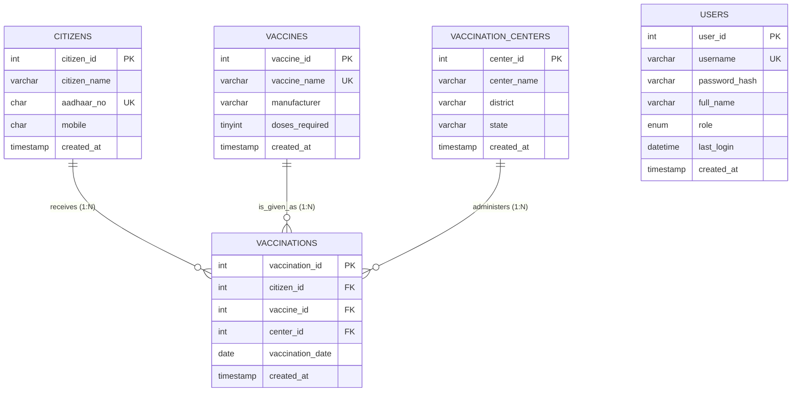

# SYSTEM ARCHITECTURE & TECHNICAL SPECIFICATION
## COVID-19 Vaccination Management System

---

## 1. 3-Tier Layered Architecture

```
+--------------------------------------------------------------------------+
|                       PRESENTATION LAYER (Frontend)                       |
|  - HTML5 & CSS3 Enterprise Grid (Dark Sidebar Theme, Max-Width 1400px)   |
|  - FontAwesome 6.5 Vector Glyphs                                         |
|  - Chart.js 4.4.2 Interactive Canvas Renderers                           |
|  - Vanilla ES6 JavaScript (Live Clock, Drawer, Toast Auto-Dismiss)        |
+--------------------------------------------------------------------------+
                                    |
                          HTTP / HTTPS (Port 80/443)
                                    |
+--------------------------------------------------------------------------+
|                    APPLICATION LAYER (Backend Node.js)                   |
|  - Node.js + Express REST API (JSON over HTTP)                            |
|  - Authentication Middleware & RBAC Permission Matrix                     |
|  - Cryptographic Engine: Blowfish / BCrypt Hashing                        |
|  - Database Access Layer: mysql2 Pooled Prepared Statements              |
|  - Contextual Sanitizer: client-side h() HTML escaping                    |
|  - Post/Redirect/Get (PRG) Pattern & Session Flash System                 |
+--------------------------------------------------------------------------+
                                    |
                           TCP Socket (Port 3306)
                                    |
+--------------------------------------------------------------------------+
|                         DATA STORAGE LAYER (MySQL)                       |
|  - MySQL 8.0 Community Server (InnoDB Storage Engine)                     |
|  - ACID Transactional Processing with Row-Level Locking                  |
|  - Declarative Relational Integrity (PK, FK, UNIQUE, CHECK Regex)        |
|  - Procedural Active Business Logic (BEFORE INSERT Trigger)              |
|  - Virtual Query Abstraction (Relational Views)                          |
|  - B-Tree Clustered & Secondary Indexes                                   |
+--------------------------------------------------------------------------+
```

---

## 2. Entity-Relationship (ER) Model



---

## 3. Relational Schema & Dependencies

* $\text{Citizens}(\underline{\text{citizen\_id}}, \text{citizen\_name}, \text{aadhaar\_no}, \text{mobile}, \text{created\_at})$
* $\text{VaccinationCenters}(\underline{\text{center\_id}}, \text{center\_name}, \text{district}, \text{state}, \text{created\_at})$
* $\text{Vaccines}(\underline{\text{vaccine\_id}}, \text{vaccine\_name}, \text{manufacturer}, \text{doses\_required}, \text{created\_at})$
* $\text{Vaccinations}(\underline{\text{vaccination\_id}}, \text{citizen\_id}^*, \text{vaccine\_id}^*, \text{center\_id}^*, \text{vaccination\_date}, \text{created\_at})$
* $\text{users}(\underline{\text{user\_id}}, \text{username}, \text{password\_hash}, \text{full\_name}, \text{role}, \text{last\_login}, \text{created\_at})$

---

## 4. Data Flow Diagram (DFD Level 1)

```
[ Healthcare Worker / User ]
            |
            | (1. Submit Inoculation Record)
            v
   [ 1.0 Validate Input ]
            |
            | (2. Validated Parameters)
            v
   [ 2.0 Check RBAC Rights ] ---> (Access Denied / Redirect)
            |
            | (3. Authorized Request)
            v
   [ 3.0 Prepared Statement Execution ]
            |
            | (4. SQL Insert via Port 3306)
            v
   [ 4.0 Database Trigger: trg_vaccinations_before_insert ]
            |
            +---> (If Count >= Required OR Date > CURDATE) ---> [ Abort & Signal SQLSTATE 45000 ]
            |
            | (5. All Integrity Checks Pass)
            v
   [ 5.0 Commit to InnoDB Ledger Table: Vaccinations ]
            |
            v
[ 6.0 Flash Notification & Response Rendered to DOM ]
```
